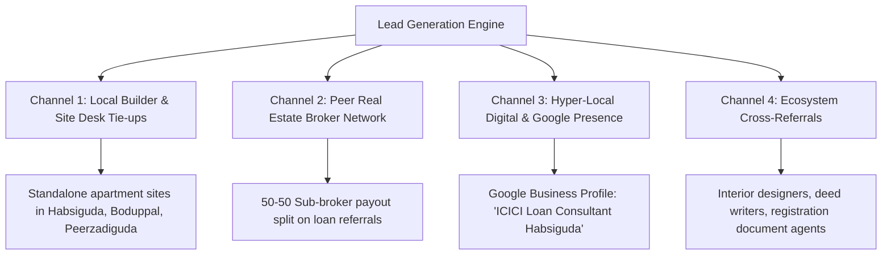
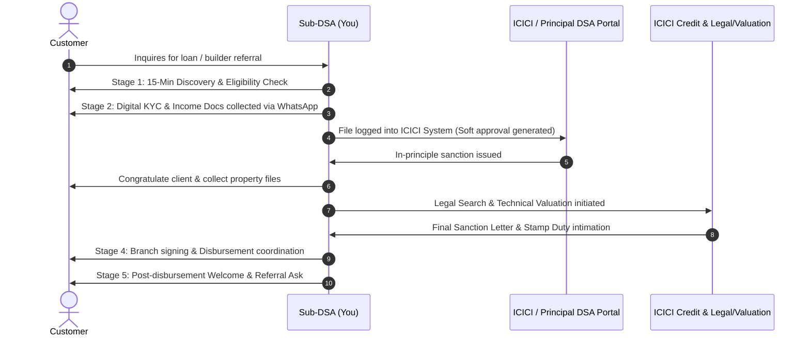

# 90-Day Sub-DSA Launch Plan: ICICI Bank / ICICI Home Finance
**Territory Focus:** Habsiguda & East Hyderabad Corridor (Uppal, Nacharam, Tarnaka, Boduppal, Pocharam IT Corridor)  
**Promoter Profile:** Real Estate Consultant / Property Advisor (Direct access to property buyers & builders)  
**Operating Model:** Solo Operator (Bootstrap budget: Under ₹30,000)

---

## Executive Summary & Strategic Edge

As an active real estate consultant in the Habsiguda–Uppal belt, you hold the highest-leverage position in loan distribution: **you capture the customer at the exact point of purchase intent**, before they ever walk into a bank branch or search on financial aggregators. 

Your 90-day mission is to transform from an occasional loan referrer into a systematic **single-window loan advisor** under ICICI Bank / ICICI Home Finance (HFC), generating predictable monthly disbursements of **₹1.5 Cr to ₹3.5 Cr+** by Month 3.

---

## 1. Loan Products to Prioritize (Approval Ease & Payout Matrix)

In a Sub-DSA setup, cash flow requires balancing **fast-turnaround, high-commission velocity products** (Personal Loans) with **high-volume, wealth-building anchor products** (Home Loans & Balance Transfers).

| Product | Priority Tier | Avg. Ticket Size | Sub-DSA Payout (Approx.)* | Turnaround Time (TAT) | Approval Ease | Strategic Value for Your Profile |
| :--- | :--- | :--- | :--- | :--- | :--- | :--- |
| **Home Loans (New Purchase / Resale / Construction)** | **Tier 1 (Core Anchor)** | ₹40 L – ₹75 L | 0.35% – 0.50% (₹14,000 – ₹37,500/case) | 7 – 12 Days | High (Salaried MNC/Govt), Moderate (Resale) | **Core Synergy:** Bundle directly with every flat, villa, and plot deal you or your broker network closes. |
| **Balance Transfer (BT) + Top-Up** | **Tier 1 (High Conversion)** | ₹35 L – ₹60 L | 0.40% – 0.55% (₹14,000 – ₹33,000/case) | 7 – 10 Days | High (Clean track record of 12+ EMIs) | High emotional pull: lowers client's existing interest rate and provides additional cash for interiors/renovation. |
| **Personal Loans (Salaried IT / Pharma / PSU)** | **Tier 2 (Cash Flow Booster)** | ₹5 L – ₹12 L | 1.20% – 1.80% (₹6,000 – ₹21,600/case) | 24 – 48 Hours | Very High (Pre-approved / Salary account) | Immediate income while large mortgages are in legal/technical scrutiny. |
| **Loan Against Property (LAP / ICICI HFC)** | **Tier 2 (High Ticket)** | ₹30 L – ₹1.2 Cr | 0.50% – 0.75% (₹15,000 – ₹75,000/case) | 12 – 18 Days | Moderate (Requires clear property title & ITRs) | Excellent for local traders, pharmacy unit owners in Nacharam/Mallapur, and shop owners on Habsiguda Main Road. |
| **Business Loans (Unsecured)** | **Tier 3 (Selective)** | ₹10 L – ₹25 L | 1.00% – 1.50% (₹10,000 – ₹37,500/case) | 3 – 5 Days | Moderate (Requires 2-3 yrs ITR, GST, clean banking) | Offer on request to business clients needing urgent working capital. |

*\*Note: Exact Sub-DSA payout percentages depend on your Principal DSA agreement slab and monthly volume achievement.*

### Why This Hierarchy Works in East Hyderabad:
1. **The Pocharam & Uppal Salaried Belt:** Infosys, Genpact, Arena IT Park, plus scientists from CCMB, IICT, and NGRI provide clean profiles (CIBIL 750+, stable salaries, PF credits) that pass ICICI automated underwriting with minimal queries.
2. **Resale & Standalone Builders in Habsiguda/Boduppal:** Local builders building 5-floor standalone apartments rarely have full-time banking desks. You become their outsourced in-house loan specialist.

---

## 2. Low-Cost Lead Generation Channels (Zero-to-Lean Budget)

Operating with under ₹30,000 means avoiding expensive paid ads and focusing on high-trust relationship channels.



### A. Offline Channels (Immediate Traction)
1. **Standalone Builder Desk Tie-ups (No-cost):**
   - Identify 10–15 ongoing residential projects (G+5 standalone buildings) in Boduppal, Peerzadiguda, Narapally, and Tarnaka.
   - Offer the builder: *"I will handle end-to-end loan approvals for your buyers through ICICI, do doorstep documentation, and get your disbursements expedited with zero cost to you."*
   - Put a clean standee/flyer at their site office: *"Preferred Home Loan Partner - ICICI Bank / HFC - Spot Eligibility Check."*
2. **Real Estate Broker Syndicate (Revenue Share):**
   - There are 50+ local independent property brokers operating around Habsiguda, Uppal, and Ramanthapur who only care about their 1%–2% property brokerage and find loan paperwork tedious.
   - Proposition: Offer them **50% of the loan commission** for every qualified buyer lead they pass to you once disbursed. You do 100% of the operational legwork.
3. **Registration Office & Sub-Registrar Proximity (Uppal & Kapra SRO):**
   - Connect with 3–4 trusted deed writers and document agents outside the Uppal and Kapra Sub-Registrar offices. They know who is buying unencumbered properties or seeking mortgage assistance.
4. **Interior Designers & Modular Kitchen Vendors:**
   - Partner with local interior shops in Habsiguda and Nagole. When new buyers approach them for quotes, they often face a ₹5L–₹10L interior budget deficit—perfect for ICICI Top-Up or Personal Loans.

### B. Online & Digital Channels (Sub-₹5,000 Setup)
1. **Google Business Profile (GBP - Essential Local SEO):**
   - Set up: *"ICICI Financial Loan Services - Habsiguda (Home Loans & Mortgage Consultant)"*.
   - Add operating hours, photos, loan eligibility info, and encourage verified client reviews. Local searches like *"ICICI home loan agent near me"* or *"Habsiguda loan consultant"* convert at >40%.
2. **Targeted WhatsApp Community Broadcasts:**
   - Create non-spammy, high-value status updates and broadcast lists for your existing property investor database.
   - Content: *"RBI repo rate update"*, *"How much home loan can you get on ₹1 Lakh salary?"*, *"Zero processing fee festive offers"*.
3. **Local Apartment RWA (Resident Welfare Association) Group Connects:**
   - In gated communities around Uppal/Ghatkesar (e.g., SMR Harmony, Modi Builders, etc.), offer a free weekend *"Home Loan Health Check & Balance Transfer Desk"* to help residents reduce their interest rate by 0.35%–0.60% via ICICI Balance Transfer.

---

## 3. Documents & KYC Checklist per Loan Product

Organize your documents digitally in standardized Google Drive / WhatsApp folders before meeting the customer.

```
📁 Customer_Name_ICICI_Product
   ├── 01_KYC (Aadhaar, PAN, Photo)
   ├── 02_Income (Salary Slips / ITR, Form 16, Bank Statements)
   ├── 03_Property (Link Documents, Sale Agreement, EC, Sanction Plan)
   └── 04_Existing_Loans (Sanction Letters, Repayment Schedules)
```

### Detailed Document Matrix

| Category | Salaried Home Loan / BT | Self-Employed / Business Loan | Personal Loan (Salaried) | Loan Against Property (LAP) |
| :--- | :--- | :--- | :--- | :--- |
| **KYC** | • PAN Card<br>• Aadhaar Card (linked to phone)<br>• 2 Passport Photos | • PAN Card (Individual + Firm)<br>• Aadhaar Card<br>• Business address proof (GST/Trade license) | • PAN Card<br>• Aadhaar Card<br>• Company ID card | • PAN Card (All co-owners)<br>• Aadhaar Card (All co-owners)<br>• Business registration proof |
| **Income Proof** | • Last 3 months Salary Slips<br>• Last 2 years Form 16 (Part A & B)<br>• Official Email ID verification | • Last 3 years ITR with Computation of Income<br>• CA-certified Balance Sheet & P&L<br>• Tax Audit Report (if turnover > threshold) | • Last 3 months Salary Slips<br>• Last 1 year Form 16 | • Last 3 years ITR with Computation<br>• Balance sheet, P&L, Audit Report |
| **Banking** | • Last 6 months Salary Account statement (PDF with bank e-stamp/password) | • Last 12 months Current Account statement (all banks)<br>• Last 6 months Savings Account statement | • Last 6 months Salary Account statement | • Last 12 months Current & Savings Account statements |
| **Property Documents** | • Registered Agreement of Sale / ATS<br>• Prior link title deeds (13 to 30 years)<br>• Encumbrance Certificate (EC) for 30 yrs<br>• Municipal/GHMC sanctioned plan & building permission<br>• Latest Property Tax Receipt<br>• Builder demand letter / NOC & Account details | • Title deeds & registered conveyance<br>• 30-year EC<br>• Sanctioned plan & occupancy certificate<br>• Tax paid receipts | N/A (Unsecured) | • Complete link chain deeds (30 years)<br>• Latest 30-year EC<br>• GHMC approved plan + Comm. / Res. permission<br>• Latest electricity bill & municipal tax receipt |
| **Obligations / Existing Loans** | • Sanction letter & 12 months loan repayment track (SOA) of existing loans | • Sanction letters, amortisation schedules, and SOA of all running credit lines / CC / OD / machinery loans | • Repayment track of ongoing active loans | • Complete SOA and sanction letters of all running commitments |

---

## 4. Customer Follow-Up & Conversion SOP

A loan lead decays rapidly if not engaged within 15 minutes. Use this 5-stage conversion protocol:



### Stage-by-Stage Operating Protocols

#### Stage 1: Instant Discovery & Qualification (Day 1 - Within 15 Mins)
- **Golden Questions to Ask:**
  1. *"What is your current company name and monthly in-hand net salary?"*
  2. *"Do you have any existing active EMIs (car loan, personal loan, credit cards)?"*
  3. *"How is your CIBIL score (above 750)?"*
  4. *"Is the target property ready-to-move, under construction, or a resale flat?"*
- Run a rapid FOIR (Fixed Obligation to Income Ratio) calculation: ICICI allows up to 50%–60% of net monthly income toward total EMIs.

#### Stage 2: Digital Docket Collection & Login (Days 1–2)
- Send a templated, formatted WhatsApp checklist for docs.
- Use ICICI digital sourcing link (e-login) to initiate mobile OTP-based Aadhaar verification and NetBanking statement fetch (via Account Aggregator). This reduces login TAT to under 30 minutes!

#### Stage 3: Legal & Technical Facilitation (Days 3–7)
- Coordinate with the assigned ICICI field valuation engineer and empaneled lawyer.
- Accompany the valuer to the site in Habsiguda/Boduppal if needed; maintain direct contact to clear any link deed queries promptly.

#### Stage 4: Sanction Letter Presentation & Branch Signing (Days 7–10)
- Personally review the sanction letter with the customer: highlight loan amount, approved tenure, ROI (floating repo-linked rate), and processing fee waivers.
- Assist the customer during the physical signing of the loan kit, ECS/e-NACH mandate, and MOE (Memorandum of Entry / Deposit of Title Deeds).

#### Stage 5: Post-Disbursement Nurture & Referral Machine (Day 15 onwards)
- Confirm the disbursement cheque/RTGS is credited to the builder or seller.
- Deliver a personalized *"Loan Service Dossier"* with their loan account number, ICICI iMobile app setup, and customer care details.
- **The Referral Trigger:** *"Mr. Rao, I'm glad we secured your loan at 8.75% with zero hassle. Do you have any colleagues at Infosys/Genpact or family members looking to buy or transfer their loan this month?"*

---

## 5. 90-Day Income Projections & Financial Model

### Core Operating Assumptions:
- **Average Home Loan Ticket Size:** ₹50,00,000 (Average for Habsiguda, Uppal, Boduppal 2BHK/3BHK)
- **Sub-DSA Net Payout on Home Loans:** 0.40%
- **Average Personal Loan Ticket Size:** ₹6,00,000
- **Sub-DSA Net Payout on Personal Loans:** 1.40%
- **Average LAP Ticket Size:** ₹45,00,000 | **Payout:** 0.50%

---

### Monthly Scenarios (Month 1 to Month 3)

#### Month 1: Pipeline Incubation (Setup & Initial Files)
| Scenario | Home Loans (Disbursed) | Personal Loans (Disbursed) | LAP (Disbursed) | Total Volume | Gross Commission | Net Monthly Income |
| :--- | :--- | :--- | :--- | :--- | :--- | :--- |
| **Conservative** | 1 Case (₹40 L) | 1 Case (₹4 L) | 0 Cases | ₹44 Lakhs | ₹16,000 + ₹5,600 | **₹21,600** |
| **Realistic** | 2 Cases (₹90 L) | 2 Cases (₹10 L) | 0 Cases | ₹1.00 Crore | ₹36,000 + ₹14,000 | **₹50,000** |
| **Optimistic** | 3 Cases (₹1.50 Cr) | 3 Cases (₹18 L) | 1 Case (₹40 L) | ₹2.08 Crores | ₹60,000 + ₹25,200 + ₹20,000 | **₹1,05,200** |

#### Month 2: Velocity & Broker Referrals Kick In
| Scenario | Home Loans (Disbursed) | Personal Loans (Disbursed) | LAP (Disbursed) | Total Volume | Gross Commission | Net Monthly Income |
| :--- | :--- | :--- | :--- | :--- | :--- | :--- |
| **Conservative** | 2 Cases (₹90 L) | 2 Cases (₹10 L) | 0 Cases | ₹1.00 Crore | ₹36,000 + ₹14,000 | **₹50,000** |
| **Realistic** | 3 Cases (₹1.50 Cr) | 4 Cases (₹24 L) | 1 Case (₹40 L) | ₹2.14 Crores | ₹60,000 + ₹33,600 + ₹20,000 | **₹1,13,600** |
| **Optimistic** | 5 Cases (₹2.60 Cr) | 6 Cases (₹36 L) | 2 Cases (₹90 L) | ₹3.86 Crores | ₹1,04,000 + ₹50,400 + ₹45,000 | **₹1,99,400** |

#### Month 3: Systematic Machine & Repeat Business
| Scenario | Home Loans (Disbursed) | Personal Loans (Disbursed) | LAP (Disbursed) | Total Volume | Gross Commission | Net Monthly Income |
| :--- | :--- | :--- | :--- | :--- | :--- | :--- |
| **Conservative** | 3 Cases (₹1.40 Cr) | 3 Cases (₹15 L) | 1 Case (₹35 L) | ₹1.90 Crores | ₹56,000 + ₹21,000 + ₹17,500 | **₹94,500** |
| **Realistic** | 5 Cases (₹2.50 Cr) | 5 Cases (₹30 L) | 2 Cases (₹80 L) | ₹3.60 Crores | ₹1,00,000 + ₹42,000 + ₹40,000 | **₹1,82,000** |
| **Optimistic** | 8 Cases (₹4.20 Cr) | 8 Cases (₹50 L) | 3 Cases (₹1.50 Cr) | ₹6.20 Crores | ₹1,68,000 + ₹70,000 + ₹75,000 | **₹3,13,000** |

---

### Initial Working Capital Allocation (Bootstrap Budget: ₹30,000)

```
┌─────────────────────────────────────────────────────────────┬──────────────┐
│ Expense Head                                                │ Budget (₹)   │
├─────────────────────────────────────────────────────────────┼──────────────┤
│ Professional Business Cards, Letterheads, & ID lanyard      │ ₹1,500       │
│ Retractable Roll-up Standees for builder site offices (3x)  │ ₹4,500       │
│ Professional Document Folder Kits for client submissions    │ ₹2,000       │
│ Dedicated Business SIM & 3-month unlimited 5G data plan     │ ₹1,200       │
│ Local travel, fuel & client meetings (Habsiguda–Pocharam)   │ ₹12,000      │
│ Broker meeting hospitality (Tea / Coffee networking)        │ ₹4,000       │
│ Contingency / Stationery / Stamp papers                     │ ₹4,800       │
├─────────────────────────────────────────────────────────────┼──────────────┤
│ TOTAL INITIAL ALLOCATION                                    │ ₹30,000      │
└─────────────────────────────────────────────────────────────┴──────────────┘
```

---

## 6. Compliance, Risk Management & Sub-DSA Governance

Operating as a Sub-DSA under ICICI carries strict operational and legal obligations under RBI guidelines. Ignoring these can result in immediate termination, blacklisting, and legal liability.

### Critical Risk Vectors & Safeguards

```
⚠️ High-Risk Areas in Loan Distribution:
├── 1. Clawback Clauses (Early foreclosure or early default)
├── 2. Mis-Selling & Unauthorized Commitments
├── 3. Data Privacy (DPDP Act 2023 compliance)
└── 4. Document Integrity & Fraud Prevention
```

1. **Clawback Protection:**
   - **What it is:** Most DSA agreements specify that if a borrower closes/forecloses their loan within 6 to 12 months, or defaults in the first 3 EMIs (Early Default), the bank/principal DSA claws back 50% to 100% of your paid commission.
   - **Safeguard:** Screen customers for genuine long-term borrowing intent. Avoid clients seeking short-term bridge funds via personal loans. Never push a customer into a loan they intend to pre-pay within 90 days.
2. **Strict Prohibition on Handling Customer Cash:**
   - **Cardinal Rule:** **Never collect cash from borrowers under any pretext** (processing fee, legal search charges, fast-track approval charges).
   - All ICICI processing fees and statutory charges must be paid directly by the borrower through official payment links, ICICI Bank crossed cheques, or direct debit from their account.
3. **Mis-Selling & Interest Rate Transparency:**
   - Always state whether an interest rate is **Fixed** or **Floating (EBLR - External Benchmark Linked Rate)**.
   - Disclose mandatory vs. optional loan protection insurance. ICICI requires property insurance on home loans, but credit life protection must be clearly explained with its cost added to the loan schedule.
4. **Data Privacy & Document Security (DPDP Act 2023):**
   - Customer Aadhaar numbers must be masked if stored physically.
   - Keep digital documents in password-protected client folders. Never share customer financial records, CIBIL reports, or salary slips across third-party WhatsApp groups or with rival builders.
5. **Zero Document Fabrication (Anti-Fraud Policy):**
   - Strictly prohibit any tampering with bank statements, salary slips, or property link deeds. Banks employ automated fraud-detection engines (Hunter, probe tools). Submitting altered documents will lead to criminal FIR and RBI-wide blacklisting of your PAN.

---

## 7. Weekly 12-Week Action Checklist (90-Day Execution Playbook)

```
Phase 1: Foundation & Onboarding (Weeks 1–4)
Phase 2: Channel Activation & Pipeline Velocity (Weeks 5–8)
Phase 3: Scale, Automation & Referral Compounding (Weeks 9–12)
```

### Phase 1: Foundation & Channel Setup (Weeks 1 to 4)

#### Week 1: Licensing, Code Generation & Product Mastery
- [ ] Complete Sub-DSA agreement signing with your Principal DSA / ICICI Bank Sales Manager.
- [ ] Receive your active ICICI sourcing code, portal logins, and mobile sourcing app access.
- [ ] Meet your dedicated ICICI Bank / HFC Loan Officers (Sales Manager, Credit Manager, and Legal Coordinator) for the Habsiguda/Uppal branch.
- [ ] Study ICICI's exact credit policy: minimum salary cutoffs, multiplier charts, negative employer list, and approved builder project lists (APF - Approved Project Financials).
- [ ] Procure business cards, WhatsApp Business catalog, and dedicated business SIM.

#### Week 2: Google Presence & Marketing Asset Deployment
- [ ] Create and verify your **Google Business Profile (GBP)** targeting Habsiguda, Uppal, and Tarnaka.
- [ ] Order 3 pull-up standees and 50 personalized presentation folders for client document handling.
- [ ] Audit your personal and professional contacts: compile a clean list of 100 past property buyers, colleagues, and acquaintances.
- [ ] Prepare standard WhatsApp message templates for Home Loan Eligibility, Balance Transfer savings, and Pre-approved Personal Loans.

#### Week 3: Builder Mapping & Initial Site Tie-ups
- [ ] Scout and map all active residential construction projects (standalone G+5 and small gated communities) in Boduppal, Peerzadiguda, Ramanthapur, and Uppal.
- [ ] Conduct in-person meetings with at least 8 builders or site sales managers.
- [ ] Secure verbal agreements with 3 builders to place your loan desk standee and handle their buyer inquiries.
- [ ] Conduct your first 5 eligibility checks for buyers visiting these sites.

#### Week 4: Broker Network Outreach & First Logins
- [ ] Connect with 15 independent real estate brokers operating in Habsiguda and Tarnaka.
- [ ] Explain your 50% revenue-share proposition for loan referrals and emphasize your doorstep document collection.
- [ ] Target your first **3 file logins** (at least 2 Home Loans + 1 Personal Loan) into the ICICI system.
- [ ] Track these files daily through credit, legal, and technical clearing.

---

### Phase 2: Pipeline Velocity & Systematization (Weeks 5 to 8)

#### Week 5: First Disbursements & Review
- [ ] Follow up aggressively to achieve your **first 2 disbursements** from Week 4 logins.
- [ ] Hand-deliver loan kits and welcome packs to the borrowers; request immediate 5-star reviews on your Google Business Profile.
- [ ] Pay your referring brokers their revenue share within 24 hours of payout clearance to establish rock-solid credibility.
- [ ] Reinvest the first commissions into local travel and fuel.

#### Week 6: Corporate & IT Employee Campaign (Pocharam / Uppal Corridor)
- [ ] Target salaried employees working in Genpact, Infosys Pocharam, and NSL Arena through LinkedIn and WhatsApp outreach.
- [ ] Roll out a *"Home Loan Balance Transfer" (BT)* campaign: identify 5 homeowners paying >9.25% to NBFCs and demonstrate annual savings of ₹40,000–₹80,000 by switching to ICICI.
- [ ] Log at least 4 new files (2 Home Loans, 1 BT, 1 Personal Loan).

#### Week 7: Interior Designer & Auxiliary Tie-ups
- [ ] Visit 5 modular kitchen and interior design studios around Habsiguda Main Road and Nagole.
- [ ] Establish a referral mechanism for clients needing Top-up or Personal Loans for interior furnishings.
- [ ] Check in with site supervisors at your partner builder sites; replenish brochures and review new footfalls.
- [ ] Maintain active pipeline: at least 6 files in various stages of credit review.

#### Week 8: Mid-Point Business Audit
- [ ] Review performance against the Month 2 Financial Projection (Target: ₹1.5 Cr+ cumulative logged volume).
- [ ] Identify bottlenecks in file processing (e.g., delay in technical reports or missing legal link deeds); meet the ICICI Credit Manager to resolve recurring queries.
- [ ] Achieve 3 to 4 disbursements for the week.

---

### Phase 3: Scale, Automation & Referral Compounding (Weeks 9 to 12)

#### Week 9: SRO & Document Agent Syndicate
- [ ] Formalize relationships with 2 deed writers / document assistants near Uppal SRO.
- [ ] Introduce a simple referral reward mechanism for genuine mortgage/LAP inquiries.
- [ ] Launch a targeted weekend campaign in 2 established apartment societies for Home Loan Top-ups and Balance Transfers.

#### Week 10: High-Ticket LAP Expansion (Nacharam / Mallapur MSME Belt)
- [ ] Target the SME/commercial ecosystem in Nacharam industrial area and Mallapur.
- [ ] Pitch ICICI Loan Against Property (LAP) for business expansion, debt consolidation, or warehouse financing.
- [ ] Log at least 1 high-ticket LAP file (₹50 Lakhs to ₹1 Crore).

#### Week 11: Systematic Client Nurturing & Review Engine
- [ ] Reach out to every customer disbursed in Month 1 and Month 2.
- [ ] Execute the "Golden Referral Trigger" (ask for 2 referrals of colleagues/friends planning to buy property).
- [ ] Ensure all Google Business Profile reviews are updated with localized keywords (*"Best ICICI home loan service in Habsiguda"*).

#### Week 12: 90-Day Review & Future Scaling Roadmap
- [ ] Conduct a full financial audit: calculate total 90-day volume disbursed, gross commission received, and ROI on the initial ₹30,000 budget.
- [ ] Assess readiness to hire your first dedicated **telecaller / documentation assistant** on a basic + incentive model for Month 4.
- [ ] Approach the Principal DSA / ICICI Area Manager to negotiate higher payout slabs based on your proven disbursement volume.

---

## 8. Daily Time-Boxing Model for the Solo Operator

To avoid burnout and ensure consistent pipeline movement, follow this daily operational schedule:

| Time Slot | Primary Activity | Focus Area |
| :--- | :--- | :--- |
| **09:30 AM – 11:00 AM** | **Branch & Credit Follow-up** | Status check on pending files with ICICI Sales Manager, valuer, and legal team. Resolving queries. |
| **11:00 AM – 01:30 PM** | **Field Visits & Builder Desk** | Visiting 2 builder sites in Boduppal/Uppal, checking buyer footfall, and meeting site managers. |
| **01:30 PM – 02:30 PM** | Lunch & Travel | Networking / informal catch-ups. |
| **02:30 PM – 04:30 PM** | **Document Collection & Doorstep Visits** | Meeting salaried clients at home or office to collect physical signatures, verify KYC, and inspect property deeds. |
| **04:30 PM – 06:30 PM** | **New Lead Generation & Broker Calls** | Calling 5 peer brokers, following up on new inquiries, running eligibility calculations. |
| **06:30 PM – 07:30 PM** | **Digital Logins & Next-Day Planning** | Uploading docs to ICICI portal, organizing Google Drive files, planning tomorrow's itinerary. |

---

*Plan formulated for immediate operational execution in Habsiguda & East Hyderabad.*
