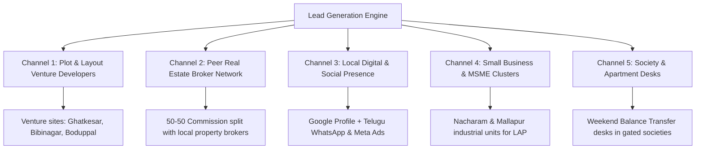

# Complete 90-Day Sub-DSA Launch Plan: ICICI Bank Loans
**Base Location:** Habsiguda, Hyderabad  
**Operating Structure:** Sub-DSA under ICICI Bank Channel Partner (Main DSA)  
**Core Geography:** Habsiguda Cluster (Uppal, Tarnaka, Nacharam, Mallapur, Ramanthapur, Nagole, Boduppal, Peerzadiguda, Ghatkesar) expanding to Pan-Hyderabad  
**Specialized Focus:** Plot Loans (Purchase & LAP), Home Loans, Mortgage/LAP, and Allied Financial Products  
**Promoter Profile:** Real Estate Consultant / Property Advisor  
**Team & Budget:** Solo Operator, Bootstrap Budget (< ₹30,000)

---

## 1. Product Priority & Underwriting Reality in Hyderabad

In Hyderabad's lending landscape, loan products have vastly different turnaround times, approval complexities, and commission payouts.

```
Product Hierarchy Strategy:
├── 1. Plot Loans (Purchase & Composite) ── Highest Local Demand, Synergy with Layouts
├── 2. Home Loans (Flats & Independent Houses) ── Core Volume Anchor, Automated Credit
├── 3. Loan Against Property (LAP on Plots/Buildings) ── High Ticket Size, High Earnings
├── 4. Personal Loans & Credit Cards ── Instant Turnaround, Fast Cash-Flow Engine
└── 5. Business / MSME Loans ── Expansion into Nacharam & Mallapur Industrial Belts
```

### Product Prioritization Matrix

| Loan Product | Priority Level | Avg. Ticket Size | Sub-DSA Payout (Approx.)* | Approval Turnaround (TAT) | Approval Ease & Bank Policy Reality | Why Prioritize First |
| :--- | :--- | :--- | :--- | :--- | :--- | :--- |
| **Plot Purchase Loan** | **Priority 1 (Special Focus)** | ₹25 L – ₹60 L | 0.35% – 0.50% | 8 – 14 Days | **Moderate:** Bank strictly requires HMDA/DTCP approval. Max 70%–75% LTV. | Unlocks the booming Warangal Highway layout market (Boduppal to Ghatkesar/Bibinagar). |
| **Composite Loan (Plot + Construction)** | **Priority 1 (High Ticket)** | ₹45 L – ₹90 L | 0.40% – 0.55% | 10 – 15 Days | **High:** Banks favor this over pure plot loans because an asset is constructed. | Higher loan eligibility, higher LTV (up to 80%), and income tax benefits for the buyer. |
| **Home Loan (Flats & Villas)** | **Priority 1 (Core Volume)** | ₹40 L – ₹80 L | 0.35% – 0.50% | 5 – 10 Days | **Very High:** Fast-tracked for salaried IT/pharma employees; automated credit processing. | Your core bread-and-butter for standalone G+5 apartments in Boduppal, Uppal, and Nagole. |
| **Loan Against Property (LAP - Residential/Plot)** | **Priority 2 (High Margin)** | ₹30 L – ₹1.5 Cr | 0.50% – 0.75% | 12 – 18 Days | **Moderate:** Requires clean 30-year link titles, approved plan, and business ITRs. | Excellent for small factory owners in Nacharam and merchants along Habsiguda Main Road. |
| **Balance Transfer (BT) + Top-Up** | **Priority 2 (Easy Win)** | ₹35 L – ₹65 L | 0.40% – 0.55% | 7 – 10 Days | **High:** Proven repayment track of 12+ months at other banks/NBFCs. | High incentive for clients paying 9.5%+ interest to switch to ICICI at lower repo rates. |
| **Personal Loans (Salaried)** | **Priority 3 (Velocity)** | ₹4 L – ₹12 L | 1.20% – 1.80% | 24 – 48 Hours | **Very High:** Pre-approved algorithms for salaried customers with salary accounts. | Delivers immediate weekly cash flow to support travel/marketing while mortgages process. |
| **Credit Cards / Consumer Loans** | **Value-Add (Zero Effort)** | Free / Pre-approved | ₹1,000 – ₹2,500 / card | Instant – 48 Hours | **Instant:** ICICI pre-approved offers via NetBanking/iMobile app. | Cross-sell freely to every home/plot loan customer upon disbursement. |

*\*Note: Sub-DSA payouts are net of Main DSA sharing ratios (typically 60%–75% of principal DSA payout passes to the Sub-DSA).*

---

### Hyderabad Plot Lending: Crucial Underwriting Rules for ICICI
1. **HMDA / DTCP Approved Layouts Only:** ICICI Bank does **not** fund unapproved Gram Panchayat plots. The layout must have a valid LP (Layout Permission) number from HMDA or DTCP.
2. **LRS (Layout Regularization Scheme) Plots:** If the plot is in an older layout, it must have an official LRS regularization order from GHMC or HMDA with fee payment receipts.
3. **NALA Conversion (Non-Agricultural Land Assessment):** Ensure agricultural conversion has been formally completed in the master title chain.
4. **Boundary Demarcation & Minimum Road Width:** The layout must have clear stone/pillar demarcation for the specific plot number and a road width of at least 30 feet (preferably 40 feet).
5. **Plot Purchase vs. Construction Timeline:** Pure plot loans often mandate that construction must begin within 2 to 3 years. For clients planning immediate construction, **always recommend a Composite Loan (Plot + House Construction)**, which unlocks higher LTV and lower interest rates.

---

## 2. Area-Wise Phased Geographic Strategy

```
Geographic Rollout Roadmap:
┌────────────────────────────────────────────────────────────────────────┐
│ Phase 1 (Weeks 1–4): Core Habsiguda Cluster                            │
│ Habsiguda • Uppal • Tarnaka • Nacharam • Mallapur • Ramanthapur • Nagole│
├────────────────────────────────────────────────────────────────────────┤
│ Phase 2 (Weeks 5–8): East Highway Plot & Expansion Belt                │
│ Boduppal • Peerzadiguda • Medipally • Narapally • Ghatkesar • Pocharam │
├────────────────────────────────────────────────────────────────────────┤
│ Phase 3 (Weeks 9–12): Secunderabad, North & Pan-Hyderabad Hubs         │
│ ECIL • Kapra • Malkajgiri • Secunderabad • LB Nagar • Dilsukhnagar     │
│ (Referrals: Kukatpally • Madhapur • Gachibowli)                        │
└────────────────────────────────────────────────────────────────────────┘
```

### Phase 1: Core Habsiguda Cluster (Weeks 1 to 4)
- **Target Audience:**
  - Salaried scientists and researchers: CSIR-CCMB, IICT, NGRI, Osmania University professors.
  - Commercial merchants along Habsiguda Main Road, Street No. 8, and Tarnaka.
  - Industrial unit owners in Nacharam and Mallapur (pharma, packaging, small manufacturing).
- **Core Product Focus:** High-ticket Home Loans, Balance Transfers, LAP, and Salaried Personal Loans.
- **Action Plan:** Establish direct visibility. Set up Google Business Profile for *"ICICI Loan Financial Services - Habsiguda"*, meet 15 local property brokers, and audit existing personal contacts.

### Phase 2: East Highway Plot & Builder Corridor (Weeks 5 to 8)
- **Target Audience:**
  - Plot buyers and open-venture developers along the Uppal–Ghatkesar–Bibinagar corridor (Warangal Highway).
  - Standalone apartment builders in Boduppal, Peerzadiguda, and Narapally.
  - Salaried tech employees in Infosys Pocharam SEZ and Genpact Uppal.
- **Core Product Focus:** **Plot Purchase Loans, Composite Loans, New Flat Loans.**
- **Action Plan:** Tie up with 5 open-layout venture promoters and 8 standalone G+5 apartment builders. Install rollup standees at venture site offices offering *"Spot ICICI Loan Eligibility"*.

### Phase 3: Secunderabad, North & Pan-Hyderabad Hubs (Weeks 9 to 12)
- **Target Audience:**
  - Defense, PSU, and railway personnel around ECIL, NFC, Moula Ali, and Secunderabad.
  - Middle-class families looking to refinance existing high-interest housing loans in Malkajgiri, Kapra, and LB Nagar.
  - Cross-city property investors buying plots in East Hyderabad but residing in Kukatpally, Madhapur, or Dilsukhnagar.
- **Core Product Focus:** Balance Transfers, Plot LAP, and Construction Top-Ups.
- **Action Plan:** Form a cross-referral alliance with West Hyderabad brokers whose clients invest in East Hyderabad land.

---

## 3. Lead Generation Channels (Zero-to-Lean Budget)

Operating solo with a sub-₹30,000 budget requires prioritizing organic, high-trust relationship channels:



### 1. Plot & Layout Venture Developers (Warangal Highway Corridor)
- **The Opportunity:** Developers launching 5–20 acre HMDA/DTCP layouts between Boduppal, Ghatkesar, and Bibinagar need bank financing partners so their buyers can book plots with 25% down payment.
- **Your Pitch:** *"Sir, I will handle ICICI Bank plot loan approvals directly for your layout buyers. I will collect all documents at their doorstep, verify CIBIL within 15 minutes, and coordinate legal search to ensure fast disbursement to your firm."*
- **Action:** Place a neat standee at their venture site office: *"Plots Approved for ICICI Bank Loans - Spot Sanctions Available"*.

### 2. Peer Real Estate Broker Network (50-50 Split Model)
- **The Opportunity:** There are over 100 active brokers between Tarnaka, Uppal, and LB Nagar. They focus entirely on their 1%–2% property commission and find bank file chasing tedious.
- **Your Pitch:** *"Pass the buyer's loan requirement to me. I do 100% of the bank visits and documentation. The day the payout clears, I transfer 50% of the loan commission directly to your account."*

### 3. Hyper-Local Digital Presence (Telugu + English)
- **Google Business Profile (GBP):** List your business as *"ICICI Financial Loans - Habsiguda (Home Loans, Plot Loans & Mortgages)"*. Local searches convert at >40%.
- **Hyper-Local Meta (Facebook/Instagram) Ads:** Spend just ₹150–₹200/day targeting men and women aged 28–50 within an 8 km radius of Uppal/Habsiguda. Use simple Telugu creative:
  - *Headline:* "హైదరాబాద్‌లో ప్లాట్ లేదా ఇల్లు కొంటున్నారా? ICICI బ్యాంక్ లోన్ కోసం సంప్రదించండి."
  - *Offer:* "Zero login charges, instant in-principle approval, doorstep document collection."

### 4. Small Business & MSME Belts (Nacharam & Mallapur)
- Visit printing, pharmaceutical packaging, metal fabrication, and auto component workshops in the Nacharam and Mallapur Industrial Development Areas (IDA).
- Pitch ICICI Loan Against Property (LAP) and Business Loans for working capital, machinery upgrade, or debt consolidation.

### 5. Apartment Association (RWA) Balance Transfer Desks
- Coordinate with RWA presidents in large communities along Uppal/Ghatkesar (e.g., SMR Harmony, Modi Builders).
- Organize a Saturday morning *"Home Loan Interest Rate Health Check Desk"*. Calculate on the spot how switching to ICICI's lower repo rate saves ₹3,000–₹8,000 on monthly EMIs.

---

## 4. Documents & KYC Checklist (Including Plot-Specific Checks)

```
Standardized Digital Folder Structure:
📁 Customer_Name_ICICI_Product
   ├── 01_KYC (Aadhaar, PAN, Photos)
   ├── 02_Income (Salary Slips / ITR, Form 16, Bank Statements)
   ├── 03_Plot_Property_Docs (Title, Link Deeds, EC, HMDA/LRS Plan)
   └── 04_Existing_Loans (Sanction Letters, Repayment Track / SOA)
```

### Comprehensive Document Requirement Matrix

| Document Category | Salaried (Plot / Home Loan) | Self-Employed (Plot / LAP / Business Loan) |
| :--- | :--- | :--- |
| **Personal KYC** | • PAN Card<br>• Aadhaar Card (mobile linked for OTP)<br>• 2 Passport size photographs<br>• Company ID card | • PAN Card (Individual + Firm)<br>• Aadhaar Card<br>• Business Registration: GST Certificate, Udyam Aadhar, Trade License |
| **Income Verification** | • Last 3 months Salary Slips<br>• Last 2 years Form 16 (Part A & Part B)<br>• Official company email verification | • Last 3 years ITR with detailed Computation of Income<br>• CA-audited Balance Sheet and Profit & Loss statement<br>• GST Returns (last 12 months) matching banking credits |
| **Banking Records** | • Last 6 months Salary Account statement (e-stamped PDF or NetBanking fetch) | • Last 12 months Current Account statements (all active banks)<br>• Last 6 months Savings Account statement |
| **Plot-Specific Legal Documents** | **Crucial Plot Scrutiny Checklist:**<br>1. **HMDA / DTCP Approved Layout Copy:** With clear LP (Layout Permission) number and stamped master drawing.<br>2. **Individual Plot Demarcation Plan:** Showing exact plot number, boundary survey numbers, and road width (minimum 30/40 ft).<br>3. **Registered Agreement of Sale (ATS):** Executed between buyer and layout promoter/seller.<br>4. **30-Year Encumbrance Certificate (EC):** Form 15 showing continuous, unbroken transaction records.<br>5. **30-Year Link Documents Chain:** Tracing ownership from original pattadar/landowner to current layout promoter.<br>6. **NALA / Conversion Order:** Revenue department certificate confirming non-agricultural conversion.<br>7. **LRS Copy (if applicable):** Formal Regularization Proceedings letter with government fee receipts.<br>8. **Latest Land Revenue / Municipal Property Tax Receipt.** |
| **Property Documents (Built House / Flat / LAP)** | • Registered Agreement of Sale / Sale Deed<br>• 30-year EC and complete link title chain<br>• GHMC / Municipal sanctioned building plan<br>• Occupancy Certificate (OC) / Assessment copy<br>• Latest property tax paid receipt<br>• Builder NOC and demand letter (for new flats) | • Registered Title Deed & complete 30-year link chain<br>• Latest 30-year EC<br>• Approved commercial/residential building plan<br>• Property tax receipts and electricity bill |
| **Existing Debt Obligations** | • Sanction letters and last 12 months Statement of Account (SOA) for all running loans (Car, Personal, Home). | • Sanction letters, amortisation schedules, and last 12 months SOA for all CC / OD limits, business loans, and mortgages. |

---

## 5. Follow-Up & Conversion Process (Bilingual WhatsApp Scripts)

### The 5-Stage Fast-Track Conversion Protocol
1. **Minute 15:** Instant Discovery Call & CIBIL/Salary qualification.
2. **Hour 24:** Digital document collection via WhatsApp; generate instant In-Principle Sanction using ICICI e-login.
3. **Day 3–5:** Legal search & technical valuation field visit coordination.
4. **Day 7–9:** Sanction letter signing, branch loan-kit execution, and e-NACH mandate setup.
5. **Day 10–12:** Disbursement cheque/RTGS release to seller/builder & referral trigger.

---

### WhatsApp Scripts in Telugu & English

#### Script 1: Initial Plot Loan Inquiry Response

**English Version:**
> *Hello [Client Name], thank you for contacting us regarding your Plot Loan requirement for your property in Hyderabad.*  
> *We facilitate hassle-free ICICI Bank Plot Loans (Purchase & Construction) with:*  
>  *Attractive interest rates linked to RBI Repo Rate*  
>  *Loan amounts up to 70%–75% of plot value (HMDA / DTCP approved layouts)*  
>  *Doorstep document collection & fast-track digital approval*  
> *To check your maximum loan eligibility in 15 minutes, please share: 1) Monthly in-hand salary / Business ITR, 2) Layout location (e.g. Ghatkesar/Boduppal), and 3) Approximate plot cost.*  
> *Regards, [Your Name] – Authorized ICICI Loan Channel Partner, Habsiguda.*

**Telugu Version (తెలుగు):**
> *నమస్కారం [Client Name] గారు! హైదరాబాద్‌లో ప్లాట్ లోన్ (Plot Purchase / Construction Loan) కోసం మమ్మల్ని సంప్రదించినందుకు ధన్యవాదాలు.*  
> *మేము ICICI బ్యాంక్ ద్వారా అతి తక్కువ వడ్డీ రేట్లతో సులభంగా ప్లాట్ లోన్స్ అందిస్తున్నాము:*  
>  *HMDA & DTCP అప్రూవ్డ్ లేఅవుట్‌లకు 70% నుండి 75% వరకు లోన్ సదుపాయం*  
>  *మీ ఇంటి వద్దకే వచ్చి డాక్యుమెంట్ల సేకరణ మరియు వేగవంతమైన శాంక్షన్*  
>  *కనీస డాక్యుమెంటేషన్ – అత్యంత వేగంగా ప్రాసెసింగ్*  
> *మీ లోన్ అర్హతను (Eligibility) కేవలం 15 నిమిషాల్లో తెలుసుకోవడానికి: మీ నెలసరి జీతం (Salary) లేదా ITR వివరాలు, ప్లాట్ ఉన్న ప్రాంతం మరియు ప్లాట్ విలువను మాకు పంపండి.*  
> *భవదీయుడు, [Your Name] – ICICI బ్యాంక్ లోన్ సర్వీసెస్, హబ్సిగూడ. ఫోన్: [Your Phone]*

---

#### Script 2: Home Loan Balance Transfer Savings Pitch

**English Version:**
> *Hello [Client Name], are you paying an interest rate of 9.25% or higher on your existing Home Loan?*  
> *Switch your loan to ICICI Bank today and save ₹3,000 to ₹7,000 every month on your EMI!*  
>  *Lower interest rates linked directly to RBI Repo Rate*  
>  *Additional Top-Up loan up to ₹25 Lakhs for home interior or personal needs*  
>  *Zero hassle – we manage the entire takeover process from your current bank*  
> *Just reply with your current outstanding loan amount to see your exact monthly savings.*

**Telugu Version (తెలుగు):**
> *నమస్కారం [Client Name] గారు! మీరు ప్రస్తుతం చెల్లిస్తున్న హోమ్ లోన్ వడ్డీ రేటు 9.25% లేదా అంతకంటే ఎక్కువగా ఉందా?*  
> *మీ హోమ్ లోన్‌ను వెంటనే ICICI బ్యాంక్‌కి ట్రాన్స్‌ఫర్ (Balance Transfer) చేసుకొని ప్రతి నెలా EMI లో ₹3,000 నుండి ₹7,000 వరకు ఆదా చేసుకోండి!*  
>  *అతి తక్కువ వడ్డీ రేట్లు*  
>  *ఇంటి ఇంటీరియర్ లేదా ఇతర అవసరాల కోసం అదనంగా Top-Up లోన్ పొందే అవకాశం*  
>  *పాత బ్యాంక్ నుండి లోన్ క్లియరెన్స్ ప్రక్రియ మొత్తం మేమే చూసుకుంటాము*  
> *మీ ప్రస్తుత లోన్ బ్యాలెన్స్ ఎంతో మాకు మెసేజ్ చేయండి, మీరు నెలకు ఎంత డబ్బు ఆదా చేయవచ్చో వెంటనే లెక్కిస్తాము.*

---

#### Script 3: Document Checklist Reminder

**English Version:**
> *Dear [Client Name], your ICICI Loan file is ready for login. To issue your in-principle sanction letter today, kindly share clear PDF copies of:*  
> *1. PAN & Aadhaar Card (both sides)*  
> *2. Last 3 months Salary Slips*  
> *3. Last 6 months Bank Statement (PDF download from NetBanking)*  
> *4. Layout / Property document copy (if finalized)*  
> *We will process your file immediately upon receipt. Thank you!*

**Telugu Version (తెలుగు):**
> *నమస్కారం [Client Name] గారు, మీ ICICI లోన్ ఫైల్‌ను ఈరోజే లాగిన్ చేసి వెంటనే శాంక్షన్ లెటర్ పొందడానికి క్రింది డాక్యుమెంట్ల PDF కాపీలను వాట్సాప్‌లో పంపగలరు:*  
> *1. పాన్ కార్డ్ & ఆధార్ కార్డ్*  
> *2. గత 3 నెలల శాలరీ స్లిప్స్*  
> *3. గత 6 నెలల బ్యాంక్ స్టేట్‌మెంట్ (నెట్ బ్యాంకింగ్ PDF)*  
> *4. ప్లాట్ / ఫ్లాట్ డాక్యుమెంట్ కాపీ*  
> *డాక్యుమెంట్లు అందిన వెంటనే మీ ఫైల్ ప్రాసెస్ చేయబడుతుంది. ధన్యవాదాలు!*

---

#### Script 4: Post-Disbursement Referral Request

**English Version:**
> *Dear [Client Name], congratulations! Your loan of ₹[Amount] has been successfully disbursed to [Seller/Builder Name].*  
> *It was an absolute pleasure assisting you. Here is your Loan Service Dossier for your records.*  
> *If you found our doorstep service helpful, could you please refer 1 or 2 friends or colleagues who are looking to buy a plot/home or transfer their existing loan? We promise to give them the same priority service.*  
> *Warm regards, [Your Name] – Habsiguda.*

**Telugu Version (తెలుగు):**
> *నమస్కారం [Client Name] గారు! అభినందనలు! మీ ₹[Amount] లోన్ మొత్తం విజయవంతంగా డిస్‌బర్స్‌మెంట్ అయ్యింది.*  
> *మీకు లోన్ సర్వీస్ అందించడం మాకు ఎంతో సంతోషాన్ని ఇచ్చింది.*  
> *మా సర్వీస్ మీకు నచ్చినట్లయితే, మీ స్నేహితులు లేదా బంధువులలో ప్లాట్ లేదా ఇల్లు కొనాలనుకునేవారు లేదా పాత లోన్ మార్చుకోవాలనుకునే 1-2 వ్యక్తులను మాకు రిఫర్ చేయగలరు. వారికి కూడా అత్యుత్తమ సేవలందిస్తాము.*  
> *ధన్యవాదాలతో, [Your Name] – హబ్సిగూడ.*

---

## 6. 90-Day Income Projections & Financial Model

### Core Commission & Payout Assumptions (Sub-DSA Net Realization)
- **Plot Purchase Loan:** Avg. ₹35 Lakhs @ 0.40% = **₹14,000 / case**
- **Composite Loan (Plot + Construction):** Avg. ₹55 Lakhs @ 0.45% = **₹24,750 / case**
- **Home Loan (Flats/Villas):** Avg. ₹50 Lakhs @ 0.40% = **₹20,000 / case**
- **Loan Against Property (LAP):** Avg. ₹45 Lakhs @ 0.50% = **₹22,500 / case**
- **Personal Loan:** Avg. ₹6 Lakhs @ 1.40% = **₹8,400 / case**
- **Balance Transfer:** Avg. ₹40 Lakhs @ 0.45% = **₹18,000 / case**

---

### Monthly Scenarios (Month 1 to Month 3)

#### Month 1: Pipeline Incubation (Setup & Initial Closures)
| Scenario | Disbursed Volume Breakdown | Total Volume Disbursed | Gross Commission Earned | Operating Expenses | Net Monthly Earnings |
| :--- | :--- | :--- | :--- | :--- | :--- |
| **Conservative** | 1 Home Loan (₹40L) + 1 Personal Loan (₹4L) | ₹44 Lakhs | ₹16,000 + ₹5,600 | ₹8,000 | **₹13,600** |
| **Realistic** | 1 Plot Loan (₹35L) + 1 Home Loan (₹50L) + 2 PL (₹10L) | ₹95 Lakhs | ₹14,000 + ₹20,000 + ₹14,000 | ₹9,500 | **₹38,500** |
| **Optimistic** | 2 Plot Loans (₹70L) + 2 Home Loans (₹1.0Cr) + 3 PL (₹18L) | ₹1.88 Crores | ₹28,000 + ₹40,000 + ₹25,200 | ₹12,000 | **₹81,200** |

#### Month 2: Velocity & Layout Tie-Ups Kick In
| Scenario | Disbursed Volume Breakdown | Total Volume Disbursed | Gross Commission Earned | Broker Split (50%) | Net Monthly Earnings |
| :--- | :--- | :--- | :--- | :--- | :--- |
| **Conservative** | 1 Plot Loan (₹35L) + 2 Home Loans (₹90L) + 2 PL (₹10L) | ₹1.35 Crores | ₹14,000 + ₹36,000 + ₹14,000 | ₹10,000 | **₹54,000** |
| **Realistic** | 2 Plot Loans (₹70L) + 2 HL (₹1.0Cr) + 1 LAP (₹45L) + 3 PL (₹18L) | ₹2.33 Crores | ₹28,000 + ₹40,000 + ₹22,500 + ₹25,200 | ₹20,000 | **₹95,700** |
| **Optimistic** | 4 Plot Loans (₹1.4Cr) + 3 HL (₹1.5Cr) + 1 LAP (₹50L) + 5 PL (₹30L) | ₹3.70 Crores | ₹56,000 + ₹60,000 + ₹25,000 + ₹42,000 | ₹35,000 | **₹1,48,000** |

#### Month 3: Systematic Referral Machine
| Scenario | Disbursed Volume Breakdown | Total Volume Disbursed | Gross Commission Earned | Broker Split (50%) | Net Monthly Earnings |
| :--- | :--- | :--- | :--- | :--- | :--- |
| **Conservative** | 2 Plot Loans (₹70L) + 3 Home Loans (₹1.4Cr) + 3 PL (₹15L) | ₹2.25 Crores | ₹28,000 + ₹56,000 + ₹21,000 | ₹20,000 | **₹85,000** |
| **Realistic** | 3 Plot Loans (₹1.05Cr) + 4 HL (₹2.0Cr) + 2 LAP (₹90L) + 5 PL (₹30L) | ₹4.25 Crores | ₹42,000 + ₹80,000 + ₹45,000 + ₹42,000 | ₹40,000 | **₹1,69,000** |
| **Optimistic** | 6 Plot Loans (₹2.1Cr) + 6 HL (₹3.0Cr) + 3 LAP (₹1.4Cr) + 8 PL (₹48L) | ₹6.98 Crores | ₹84,000 + ₹1,20,000 + ₹70,000 + ₹67,200 | ₹65,000 | **₹2,76,200** |

---

### Working Capital Allocation (Bootstrap Budget: ₹30,000)
```
┌─────────────────────────────────────────────────────────────┬──────────────┐
│ Expense Item                                                │ Budget (₹)   │
├─────────────────────────────────────────────────────────────┼──────────────┤
│ Professional Business Cards, Letterhead, & ID Lanyard       │ ₹1,500       │
│ Roll-up Standees for Layout Site Offices (3 units @ ₹1,500) │ ₹4,500       │
│ Professional Document Folder Kits for Client Dossiers       │ ₹2,000       │
│ Dedicated Business SIM & 3-Month Unlimited 5G Plan          │ ₹1,200       │
│ Local Fuel & Travel (Habsiguda – Uppal – Ghatkesar belt)    │ ₹11,000      │
│ Broker Networking Hospitality (Tea / Coffee catch-ups)      │ ₹4,000       │
│ Hyper-Local Facebook/Instagram Ad Trial (Telugu creative)   │ ₹3,000       │
│ Contingency / Printouts / Stationery                        │ ₹2,800       │
├─────────────────────────────────────────────────────────────┼──────────────┤
│ TOTAL 90-DAY ALLOCATION                                     │ ₹30,000      │
└─────────────────────────────────────────────────────────────┴──────────────┘
```

---

## 7. Compliance, Main DSA Agreement & Risk Governance

```
⚠️ Core Regulatory & Operational Safeguards:
├── 1. Sub-DSA vs. Main DSA Master Contract
├── 2. Strict RBI Branding & Logo Restrictions
├── 3. Clawback Clauses (Foreclosure / Early Default)
├── 4. Zero Cash Handling Rule
└── 5. Data Privacy (DPDP Act 2023)
```

1. **Sub-DSA Agreement with Main DSA:**
   - Ensure your agreement explicitly details: **Payout percentage per product**, **payout payment date** (e.g., by 10th of following month), **TDS deduction certificate (Form 16A)** under Section 194H, and **dispute resolution mechanism**.
   - Insist that files are logged under your sub-code or tagged with your unique identifier in the ICICI sourcing portal.
2. **Brand Usage & Misrepresentation (RBI Guidelines):**
   - **Never** present yourself as a direct *"ICICI Bank Employee"*.
   - On visiting cards, flyers, and social media, the wording must strictly be:  
     `[Your Agency Name] - Authorized Channel Partner / Direct Sales Associate for ICICI Bank Loans`.
   - Never print the standalone ICICI logo without authorized channel partner branding disclaimers.
3. **Clawback Protection & Early Default Risk:**
   - **Rule:** If a borrower forecloses/pre-pays the loan within 6 to 12 months, or defaults within the first 3 EMIs, the bank/Main DSA will claw back 50% to 100% of your commission.
   - **Protection:** Screen customers carefully. Never process loans for clients seeking short-term bridge finance or speculative property flipping.
4. **Zero Cash Collection Policy:**
   - **Never collect cash from customers under any circumstance.**
   - All ICICI processing fees, franking charges, and legal/valuation fees must be paid directly by the borrower through official ICICI payment links, crossed account-payee cheques, or direct debit.
5. **Data Privacy & Fraud Prevention (DPDP Act 2023):**
   - Mask Aadhaar numbers on paper copies.
   - Never post client salary slips, bank statements, or CIBIL reports in public WhatsApp groups.
   - Zero tolerance for document alteration. ICICI uses automated fraud detection tools (Hunter, Probe). Submitting doctored pay slips or bank PDFs results in criminal FIR and lifetime PAN blacklisting across all Indian financial institutions.

---

## 8. Weekly Action Checklist for 12 Weeks (90-Day Execution)

```
Phase 1: Foundation, Licensing & Local Setup (Weeks 1 to 4)
Phase 2: Venture Tie-ups & Pipeline Velocity (Weeks 5 to 8)
Phase 3: Scale, Secunderabad Expansion & Compounding (Weeks 9 to 12)
```

### Phase 1: Foundation & Local Setup (Weeks 1 to 4)

#### Week 1: Onboarding, Code Setup & Credit Policy
- [ ] Finalize Sub-DSA agreement with the Main DSA; obtain your ICICI sourcing sub-code and mobile portal login.
- [ ] Meet the ICICI Branch Sales Manager, Loan Officer, and Credit Manager for Habsiguda/Uppal branch.
- [ ] Understand ICICI's local policy: Approved Layout Project list (APF), negative area list, minimum salary multipliers, and plot loan LTV guidelines.
- [ ] Procure dedicated business SIM, professional visiting cards, and branded presentation folders.

#### Week 2: Digital Asset Creation & Broker Audit
- [ ] Create and verify your **Google Business Profile** targeting *"ICICI Loan Financial Services - Habsiguda"*.
- [ ] Compile an audit list of 100 past property clients, builder friends, and personal contacts.
- [ ] Set up WhatsApp Business with quick-reply templates in English and Telugu (using the scripts above).
- [ ] Order 3 pull-up standees: *"Plots & Homes Approved for ICICI Loans – Spot Eligibility Check"*.

#### Week 3: Layout Developer Mapping (Ghatkesar & Warangal Highway)
- [ ] Scout and map 10 ongoing open-plot ventures between Boduppal, Medipally, Ghatkesar, and Pocharam.
- [ ] Meet with at least 5 venture promoters / sales heads; pitch ICICI plot loan desk tie-ups.
- [ ] Secure permission to place standees at 2 active venture site offices.
- [ ] Conduct your first 5 plot loan eligibility assessments for walk-in site buyers.

#### Week 4: Broker Network Outreach & First Logins
- [ ] Meet 15 independent real estate brokers in Habsiguda, Tarnaka, and Ramanthapur with the 50/50 commission split proposal.
- [ ] Target your first **3 file logins** into the ICICI system (1 Plot Loan + 1 Home Loan + 1 Personal Loan).
- [ ] Track documents daily with the ICICI credit and legal search teams.

---

### Phase 2: Venture Tie-Ups & Pipeline Velocity (Weeks 5 to 8)

#### Week 5: First Disbursements & Milestone Celebration
- [ ] Aggressively follow up to achieve your **first 2 disbursements** from Week 4 logins.
- [ ] Deliver a physical loan dossier and congratulate the clients; request immediate 5-star reviews on Google Business Profile.
- [ ] Pay your referring brokers their 50% split within 24 hours of commission receipt to build unshakeable credibility.
- [ ] Reinvest earnings into fuel and marketing materials.

#### Week 6: Corporate Corridor & Balance Transfer Campaign
- [ ] Run a targeted Balance Transfer campaign for IT employees in Pocharam SEZ (Infosys) and NSL Arena (Genpact) using Telugu/English WhatsApp copy.
- [ ] Identify 5 homeowners paying >9.25% interest and show them concrete savings by transferring to ICICI.
- [ ] Log at least 4 new files (2 Home Loans, 1 Plot Loan, 1 BT).

#### Week 7: G+5 Standalone Builder Tie-Ups
- [ ] Meet 8 standalone G+5 apartment builders in Boduppal, Peerzadiguda, and Nagole.
- [ ] Offer in-house loan coordination for their flat buyers with zero hassle to the builder.
- [ ] Check in with site supervisors at your partner plot layouts; replenish brochures and review weekend footfall.
- [ ] Maintain an active pipeline of at least 6 files under credit review.

#### Week 8: Mid-Point Business & Pipeline Audit
- [ ] Review progress against Month 2 targets (Target: ₹1.5 Cr+ cumulative logged volume).
- [ ] Address bottlenecks with the ICICI Credit Manager (e.g., link document queries or valuation delays).
- [ ] Achieve 3 to 4 disbursements for the week across plot and home loan products.

---

### Phase 3: Scale, City Expansion & Compounding (Weeks 9 to 12)

#### Week 9: SRO Proximity & Sub-Registrar Network
- [ ] Connect with 3 trusted deed writers and document agents outside Uppal and Kapra Sub-Registrar Offices (SRO).
- [ ] Establish a referral mechanism for property transactions needing instant mortgage funding.
- [ ] Organize a Saturday morning Home Loan & Top-Up desk in a large gated society in Uppal/Boduppal.

#### Week 10: MSME & Industrial LAP Expansion (Nacharam/Mallapur)
- [ ] Tour the Nacharam and Mallapur Industrial Development Areas (IDA).
- [ ] Pitch ICICI Loan Against Property (LAP) and Business Loans to 10 manufacturing and pharma packaging units.
- [ ] Log at least 1 high-ticket LAP file (₹50 Lakhs to ₹1 Crore).

#### Week 11: Customer Referral Engine Activation
- [ ] Contact every customer disbursed in Months 1 and 2 using Script 4 (Referral Request).
- [ ] Aim for 4 qualified referrals of colleagues or relatives looking to buy plots or homes.
- [ ] Launch a ₹200/day localized Facebook/Instagram ad campaign targeting plot buyers along the Warangal Highway corridor.

#### Week 12: 90-Day Performance Audit & Scaling Plan
- [ ] Conduct a full financial audit: total disbursed volume, gross commission, broker payouts, and net profit.
- [ ] Evaluate hiring your first part-time telecaller / documentation executive for Month 4 on a basic + incentive structure.
- [ ] Schedule a formal review with your Main DSA / ICICI Area Manager to negotiate higher commission slabs based on your proven quarterly volume.

---

## 9. Daily Operational Schedule for the Solo Operator

| Time Slot | Key Focus | Operational Activities |
| :--- | :--- | :--- |
| **09:00 AM – 10:30 AM** | **Branch & Credit Follow-Up** | Status review of pending files with ICICI Sales Manager, panel lawyer, and valuation engineer. Clearing credit queries. |
| **10:30 AM – 01:30 PM** | **Venture & Builder Visits** | Visiting 2 plot venture sites or builder offices in Boduppal/Ghatkesar. Meeting sales managers and collecting weekend buyer leads. |
| **01:30 PM – 02:30 PM** | Lunch & Travel Catch-up | Quick client WhatsApp follow-ups and informal networking. |
| **02:30 PM – 04:30 PM** | **Doorstep Document Collection** | Visiting salaried clients or business owners at home/office to collect original KYC, inspect property link deeds, and sign forms. |
| **04:30 PM – 06:30 PM** | **Broker Calling & Lead Generation** | Calling 5 local brokers, following up on new inquiries, running rapid CIBIL/FOIR eligibility calculations. |
| **06:30 PM – 07:30 PM** | **Digital Logins & Daily Wrap** | Uploading soft copies to ICICI e-login portal, updating Google Drive folders, and setting tomorrow's field visit itinerary. |

---

*This blueprint provides an exhaustive, locally optimized operating framework tailored specifically for Habsiguda, East Hyderabad, and the surrounding layout growth corridors.*
